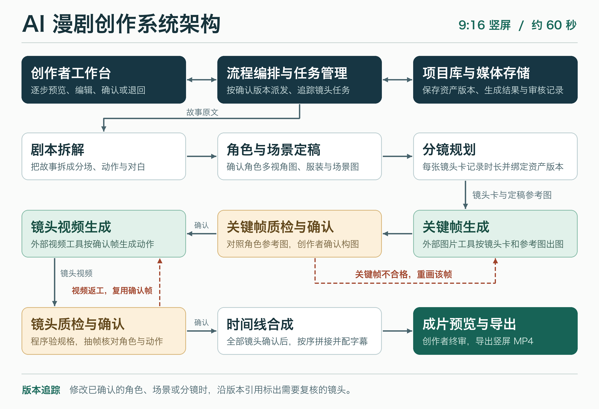

# netease_agent
Capstone part_C

## AI 漫剧创作工作台

把一段故事做成一集 9:16、目标 60 秒的漫剧。本仓库实现了可以操作和测试的制作流程。创作者在网页里审剧本、定角色和场景、调分镜、审核关键帧与镜头视频，最后确认时间线。

## 本地运行

在仓库根目录运行以下命令。需要 Python 3.10 或更高版本，依赖均来自标准库。

```sh
python3 -m comic_studio
```

打开 [本地工作台](http://127.0.0.1:8000)。首页有一个三镜头示例，可以直接开始，也可以改成自己的故事。项目和历史版本默认写入 `data/studio.sqlite3`，重启后可继续。可用 `--port` 和 `--db` 指定端口和数据库路径。

## 怎样体验两条返工路径

1. 新建一集，确认剧本。生成并定稿角色、场景和分镜卡。可在角色卡编辑外貌、服装和参考图，在分镜卡调整动作、对白和时长。
2. 生成某一镜的关键帧。发现人物或构图错误时，填写原因并退回，重新出图。该帧通过确认后才可生成视频。
3. 审核视频时，如果角色在动作中途变脸，选择「复用确认帧，重做本镜视频」。如果回看时发现首帧就画错，选择「关键帧画错，退回出图」。新生成的版本都需要复审。
4. 全部镜头确认后生成时间线，核对镜头顺序、字幕、起止时间，再终审并下载 `timeline.json`。此后修改角色、场景或某张分镜，工作台会标记依赖它的镜头，并要求重新终审时间线。

## 模块



| 模块 | 代码 | 职责 |
| --- | --- | --- |
| 创作者工作台 | [web.py](comic_studio/web.py) · [workbench.py](comic_studio/workbench.py) | 新建和恢复项目，预览、修改、确认、退回及导出 |
| 流程编排与任务 | [workflow.py](comic_studio/workflow.py) | 按依赖派发任务，锁定上游版本，确定返工范围 |
| 剧本、角色与分镜 | [providers.py](comic_studio/providers.py) · [validation.py](comic_studio/validation.py) | 故事拆镜，校验角色和场景引用，生成带时长和对白的分镜卡 |
| 关键帧、镜头视频与质检 | [providers.py](comic_studio/providers.py) | 图片工具接收分镜和已确认资产，视频工具另接收已确认关键帧。校验素材地址、版本、画幅、时长及字幕 |
| 项目与媒体索引 | [store.py](comic_studio/store.py) | SQLite 保存原文、版本引用、素材地址、任务结果、质检问题和审核记录。旧页面提交会触发版本冲突提示 |
| 时间线与导出 | [timeline.py](comic_studio/timeline.py) | 按剧本顺序拼接已确认的视频引用，计算每条字幕和镜头的起止时间 |

每份产物都有独立版本。镜头卡记录使用的角色和场景版本，关键帧记录镜头卡和参考资产版本，视频记录关键帧和镜头卡版本，时间线记录每个镜头的视频版本。修改共用角色会影响它出场的所有镜头，修改某个镜头独用的场景只影响该镜及后续合成。此前的版本和审核意见可追溯。

## 接入真实生成工具

当前生成任务在本地同步执行。拆镜使用确定性示例规则，图片和视频由模拟适配器返回 `mock://` 素材引用。工作台展示占位预览，终审输出可供渲染器消费的 JSON 剪辑清单。视觉身份识别、真实媒体生成和 MP4 编码属于后续接入范围。

- 实现 `StoryPlanner.plan` 可接入文本模型。输出包含角色、场景和镜头列表，具体字段见 `DemoPlanner`。
- 实现 `MediaTools.keyframe` 和 `MediaTools.video` 可替换图片及视频服务。请求携带任务 ID、定稿镜头、引用资产及版本、返工意见。视频调用还会收到选定关键帧的地址与版本。
- 实现 `Inspector` 可增加图像相似度或视频抽帧检查。已有检查针对产物元数据，人物外观和动作由创作者复核。质检未通过会阻止确认。
- 使用 `create_app(store, StudioTools(planner=..., media=..., inspector=...))` 注入实现。真实服务可将媒体文件写入对象存储，将返回的地址保存在项目记录里。渲染器可以按剪辑清单生成竖屏 MP4。

## 验证

```sh
python3 -m unittest discover -s tests -v
```

测试覆盖逐级确认、两种返工路径、参考资产变更的影响范围、质检拦截、生成失败重试、项目重开、并发版本冲突和网页表单到最终清单的完整流程。
